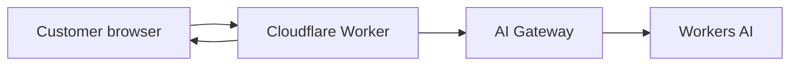

# EdgePilot - Cloudflare AI Architecture Advisor

EdgePilot is a customer-facing proof of concept built on the Cloudflare Developer Platform. A customer describes an AI workload and receives a concise architecture recommendation covering request flow, security, resilience, cost controls, trade-offs, and a two-week PoC.

This project is intentionally aligned to a Senior Solutions Architect conversation: discovery first, then a working architecture, not a generic chatbot.

## What Cloudflare does in this project

| Cloudflare capability | How EdgePilot uses it | Customer value demonstrated |
|---|---|---|
| Cloudflare Workers | Serves the UI, validates requests, applies policy, and orchestrates inference | Globally distributed serverless application layer with no servers to manage |
| Workers AI | Runs the Llama 3.3 model through the `AI` binding | Serverless GPU inference without provisioning model infrastructure |
| AI Gateway | Every inference uses the `default` gateway | Model analytics, logging, caching policy, limits, retries, and future fallback |
| Workers Observability | Enabled in `wrangler.jsonc` | Operational visibility for a production path |
| Cloudflare security headers | Applied by the Worker to every response | A secure-by-default application boundary |

The recommendation engine also explains when to add Access, Vectorize, R2, D1, Durable Objects, Turnstile, and WAF. They are not provisioned merely to inflate the architecture.

## Architecture



For regulated or internal data, EdgePilot instructs AI Gateway to bypass prompt caching. Public, reusable scenarios may use gateway caching. This deliberately demonstrates that architecture choices follow data classification.

## Run locally

Prerequisites: Node.js 20+ and a Cloudflare account.

```bash
npm run dev
```

Workers AI always accesses the Cloudflare account, even during local development. Wrangler will request authentication if needed.

## Test

```bash
npm test
```

Tests verify the UI route, validation, Workers AI call, AI Gateway selection, and sensitive-data cache policy.

## Deploy to Cloudflare

```bash
npx wrangler@latest login
npm run deploy
```

The deployment produces `https://edgepilot-ai-architecture-advisor.<your-subdomain>.workers.dev`. Open `/api/health` to verify the Worker, AI binding, gateway, and model.

## 90-second demo for a hiring conversation

1. Open EdgePilot and select **Regulated bank**.
2. Explain that the left side captures customer requirements before choosing products.
3. Generate the design and point out the live request path: Worker → AI Gateway → Workers AI.
4. Highlight that caching is bypassed for regulated prompts but allowed for appropriate public content.
5. Show AI Gateway analytics and logs in the Cloudflare dashboard.
6. Close with the next PoC step: add approved documents in R2 and semantic retrieval with Vectorize, then protect internal access with Cloudflare Access.

## Honest limitations

- This is a focused PoC, not a production reference architecture.
- The built-in product context is curated in code; the next iteration should ground responses in approved documents using R2 and Vectorize.
- Identity, data residency, retention, model fallback, and compliance must be validated for each customer.
- The deterministic fallback keeps the demo usable if inference is unavailable, and the response identifies that mode through the API.

See [docs/STEP-BY-STEP.md](docs/STEP-BY-STEP.md) for the implementation story and interview talking points.
